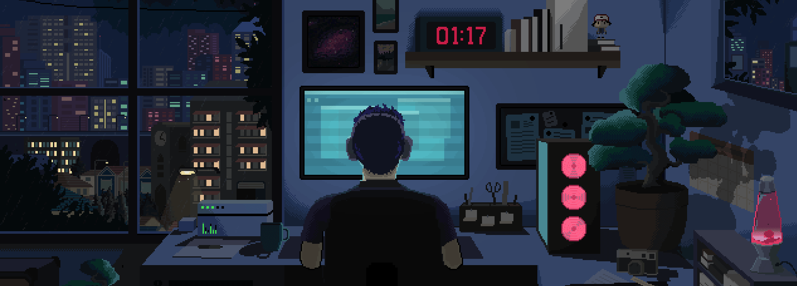

  

# Hi 👋, I'm Juljan Halilaj

**Computer Science & AI Graduate**  
🎓 University of York, CITY College  
🌍 Greece  
💡 Working on AI, full-stack applications, and Python desktop tools  
📬 halilaj.juljan@gmail.com  

---

## Connect With Me

  
  

## Languages & Tools

  
  
  
  
  
  
  
  
  
  
  
  
  
  
  

---

## Featured Projects

### [**AI Tutor Project**](https://github.com/jhalilaj/my-ai)
My graduation thesis: a learning platform that turns uploaded documents into lessons and quizzes, with AI chat, feedback, and progress tracking.

**Next.js · TypeScript · React · MongoDB · OpenRouter**

### [**FNIRSI DPOS350P WaveForm Reader**](https://github.com/jhalilaj/FNIRSI-DPOS350P-WaveForm-Reader)
A Windows desktop app for opening saved oscilloscope waveforms, comparing channels, taking cursor measurements, and exporting data.

**Python · PySide6 · PyQtGraph · NumPy**

---

